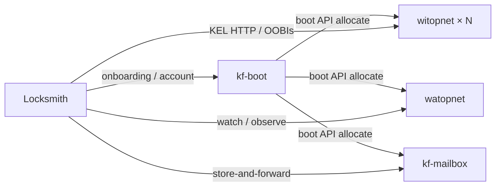
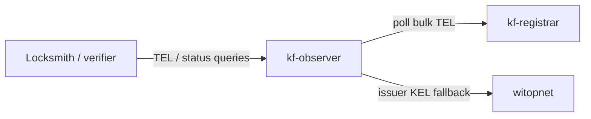
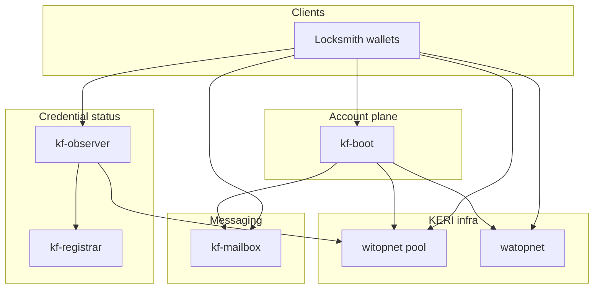

# KERI Foundation operational stack

High-level guide to the services that make up a deployable KERI Foundation pool: what each piece does, how they connect, and how many of each you typically run.

For step-by-step install, ports, Circus/systemd, and nginx, see **[full_setup_guide.md](./full_setup_guide.md)**. For a local four-host layout on one machine, use this repo’s **`docker-compose.yml`**.

---

## Introduction

This stack gives wallets a place to **onboard**, receive **hosted witnesses and watchers**, exchange messages through a **mailbox**, and query **credential status** without each operator reinventing those surfaces.

| Layer | Role |
|-------|------|
| **Wallet** | End-user key custody, identifiers, ACDCs, IPEX — **Locksmith** |
| **Account / onboarding** | Discover options, authenticate, allocate infra — **kf-boot** |
| **KERI infrastructure** | Persist and serve KELs; observe for duplicity — **witopnet**, **watopnet** |
| **Messaging** | Store-and-forward for wallet-to-wallet traffic — **kf-mailbox** |
| **Credential status** | TEL bulk registry + verified queries — **kf-registrar**, **kf-observer** |

Everything below sits on **[keripy](https://github.com/WebOfTrust/keripy)** (the Python KERI reference implementation). The operational packages are separate GitHub repos; they are not published to PyPI yet, so installs use `git+https://…` (see the setup guide §4).

---

## Services

### Locksmith

| | |
|---|---|
| **Repo** | [keri-foundation/locksmith](https://github.com/keri-foundation/locksmith) |
| **What it is** | Desktop / host wallet for KERI identifiers, ACDC credentials, and IPEX exchange |
| **Purpose** | User-facing key custody and UX. Creates AIDs locally, talks to **kf-boot** for onboarding and account APIs, uses allocated witnesses/watchers/mailbox, and talks to **kf-observer** for TEL/status queries |
| **Runs where** | On the user’s machine (or a workstation), not on the pool hosts |

Locksmith does **not** replace witnesses or the boot service. It is the client of this stack. In development, point it at Boot with `KF_DEV_ONBOARDING_URL` / `KF_DEV_ACCOUNT_URL` (defaults target local Boot on `:9723`).

---

### kf-boot

| | |
|---|---|
| **Repo** | [keri-foundation/kf-boot](https://github.com/keri-foundation/kf-boot) |
| **What it is** | HTTP boot / onboarding / account service |
| **Purpose** | Public bootstrap discovery, authenticated onboarding, approved-account management, and **allocation** of hosted witnesses, watchers, and mailboxes via their **boot** APIs |
| **Runs where** | Typically one instance behind TLS (nginx → loopback) |

**Owns:** bootstrap config, onboarding and account surfaces, session/account metadata, signed replies, calling witness/watcher/mailbox boot URLs.

**Does not own:** local AID creation, key custody, signing for users, or the witness/watcher protocols themselves.

---

### witopnet (witness-hk)

| | |
|---|---|
| **Repo** | [keri-foundation/witness-hk](https://github.com/keri-foundation/witness-hk) |
| **Process** | `witopnet` |
| **What it is** | KERI **witness** — accepts and serves key event logs for controllers that designated it |
| **Purpose** | Availability and receipting for KELs. Witnesses store and serve; they do **not** assert identity or act as a CA |
| **Runs where** | One process per witness identity; usually one per host in a multi-host pool |

Each instance has its own config, database (`--base`), **boot** port (operator API for **kf-boot**), and **HTTP** port (URLs in `curls` that wallets use).

---

### watopnet (watcher-hk)

| | |
|---|---|
| **Repo** | [keri-foundation/watcher-hk](https://github.com/keri-foundation/watcher-hk) |
| **Process** | `watopnet` |
| **What it is** | KERI **watcher** — observes KELs for duplicity and related monitoring |
| **Purpose** | Independent observation so relying parties can detect forks / conflicting evidence. Watchers observe; the relying party enforces policy |
| **Runs where** | One or more instances; **kf-boot** allocates against a single configured watcher backend |

Same boot vs public URL split as witnesses.

---

### kf-mailbox

| | |
|---|---|
| **Repo** | [keri-foundation/kf-mailbox](https://github.com/keri-foundation/kf-mailbox) |
| **What it is** | Store-and-forward **mailbox** provider |
| **Purpose** | Deliver IPEX and other store-and-forward traffic between wallets when peers are offline. Bound to account provisioning, not “mailbox via witness” |
| **Runs where** | Typically one instance; **kf-boot** allocates over the mailbox **boot** URL; wallets use the **public** URL returned at allocation |

---

### kf-registrar

| | |
|---|---|
| **Repo** | [keri-foundation/kf-registrar](https://github.com/keri-foundation/kf-registrar) |
| **What it is** | ACDC **TEL registrar** (bulk transaction event log for observers) |
| **Purpose** | Hold and serve TEL state that **observers** consume. Issuance/revocation anchoring for credential status at scale |
| **Runs where** | Usually one instance for a Foundation-style deployment |

Wallets do **not** talk to the registrar directly; **kf-observer** does.

---

### kf-observer

| | |
|---|---|
| **Repo** | [keri-foundation/kf-observer](https://github.com/keri-foundation/kf-observer) |
| **What it is** | Verified **TEL query** service |
| **Purpose** | Wallet- and verifier-facing credential status / TEL queries. Polls the registrar; can fall back to a witness for issuer KELs when needed |
| **Runs where** | Usually one instance; introduce its AID+KEL to the registrar at deploy time |

---

## How the services work together

### Planes: boot vs public

| Plane | Who uses it | Why |
|-------|-------------|-----|
| **Boot** | **kf-boot** → witness / watcher / mailbox management APIs | Operator allocation; firewall so only Boot (and ops) can reach it |
| **Public** | Locksmith / wallets / verifiers | URLs that appear in `curls`, OOBIs, and allocation payloads |

Boot and public need not share a hostname. Boot must be reachable **from kf-boot**. Public must be reachable **from clients**.

### Onboarding and account allocation

1. Locksmith loads bootstrap config from **kf-boot** (account options such as `1-of-1` or `3-of-4`).
2. User completes onboarding; **kf-boot** authenticates and creates account metadata.
3. **kf-boot** calls witness **boot** APIs (and watcher / mailbox boot) to allocate hosted endpoints.
4. Locksmith receives public witness / watcher / mailbox URLs and uses those for ongoing KERI and messaging.

### Credential status (TEL)

Issuers and holders interact with TELs through the wallet; the pool’s TEL path is registrar → observer → wallet:

At deploy time the observer’s AID and KEL are introduced to the registrar (`POST /introductions`) so the registrar allow-lists that observer. See the setup guide §§6–7.

### End-to-end picture

---

## Recommended deployment

These are practical defaults for a Foundation-style **operational network**, not protocol minimums. Adjust for load and threat model.

| Service | Recommended count | Notes |
|---------|-------------------|--------|
| **witopnet** | **4** | Enables a frozen **`3-of-4`** witness threshold in **kf-boot**. Fewer than four backends means Boot will not offer `3-of-4`. Run each witness on a separate host when you care about independent failure domains |
| **watopnet** | **≥ 1** for allocation; **4** co-located with witnesses is fine | Boot allocates against **one** watcher backend (`KF_BOOT_WAT_*`). Extra watchers on other hosts are optional local endpoints unless you repoint Boot at them |
| **kf-boot** | **1** | Single onboarding/account authority for the pool. Put it behind TLS; keep the process on loopback |
| **kf-mailbox** | **1** for most needs | Scale out later if store-and-forward volume demands it. Does not need to share a host with Boot—only Boot must reach mailbox **boot**, and clients the **public** URL |
| **kf-registrar** | **1** for most needs | One bulk TEL registrar per deployment is enough until you have multi-region or isolation requirements. Not client-facing |
| **kf-observer** | **1** for most needs | Client-facing status queries. Add more only when you need capacity or geographic proximity; each must be introduced to the registrar |
| **Locksmith** | **1 per user / role** | Client software. Demo setups often run issuer, holder, and verifier vaults as three processes |

### Suggested host co-location

A balanced four-host layout (one “extra” service per machine) is documented end-to-end in the setup guide and mirrored by Docker Compose:

| Host | Always | Plus |
|------|--------|------|
| 1 | witopnet, watopnet | **kf-boot** (+ nginx) |
| 2 | witopnet, watopnet | **kf-registrar** |
| 3 | witopnet, watopnet | **kf-observer** |
| 4 | witopnet, watopnet | **kf-mailbox** |

### Startup order (conceptual)

1. Witnesses and watchers on every host  
2. Observer (habitat + AID/KEL), then registrar + introduction  
3. Mailbox  
4. kf-boot (needs witness boots and mailbox boot reachable)

---

## Where to go next

| Need | Document |
|------|----------|
| Bare-metal install, Circus, nginx, env vars | [full_setup_guide.md](./full_setup_guide.md) |
| Local four-host Docker | [full_setup_guide.md § Local Docker](./full_setup_guide.md#local-docker) / `docker-compose.yml` |
| kf-boot API contract | [README.md](./README.md) |
| Locksmith + KF plugin | [locksmith](https://github.com/keri-foundation/locksmith) docs |
